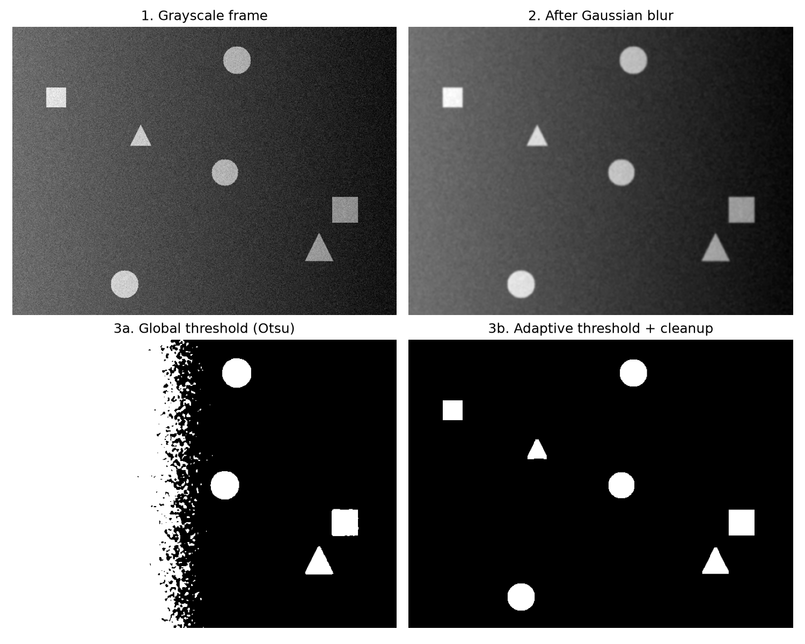
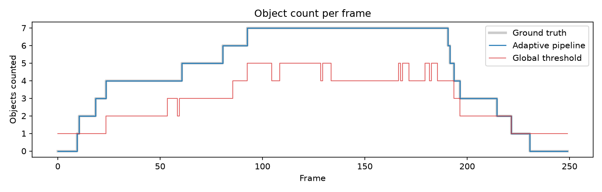
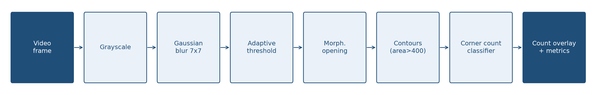

# Real-Time Shape Detection & Counting Pipeline (OpenCV)

A computer vision pipeline that processes a video frame by frame, segments moving objects with
**Gaussian filtering and adaptive thresholding**, classifies each contour as a **circle, square or triangle**,
and overlays a **live count per class** on every frame. Each frame is evaluated against ground truth for
accuracy and inference speed. Built as Task 4 of the Progree Remote Internship in Artificial Intelligence.


## Results

Evaluated on a 250-frame test video (640x480, 25 FPS) with uneven lighting and camera noise:

| Metric | Result |
|---|---|
| Total object count correct (adaptive threshold) | **100.0%** of frames |
| Total object count correct (global Otsu baseline) | 6.8% of frames |
| All class counts exactly right | **97.2%** of frames |
| Per-class count accuracy | circle 100%, square 97.2%, triangle 97.2% |
| Average inference time (Google Colab, CPU) | **8.67 ms per frame = 115 FPS** |
| Slowest frame | 17.12 ms (real-time budget at 25 FPS: 40 ms) |

The adaptive threshold handles the lighting gradient where a single global threshold fails:





The only errors (7 of 250 frames) are one small, dim triangle whose blurred tip produces a 4-vertex outline and is
reported as a square. See the [full whitepaper](report/Task4_Computer_Vision_Whitepaper.pdf) for the error analysis,
per-stage timing, parameter sensitivity and noise-robustness tests.

## Pipeline



1. **Grayscale** conversion.
2. **Gaussian blur** (7x7) to suppress noise.
3. **Adaptive threshold** (Gaussian-weighted, 101x101 block, C = -15): a pixel is foreground if it is clearly brighter than its local neighbourhood.
4. **Morphological opening** (5x5) to remove specks.
5. **Contours** (external, area > 400 px).
6. **Classification** with `approxPolyDP` (epsilon = 4% of perimeter): 3 vertices = triangle, 4 = square, more = circle.
7. **Overlay** of outlines, labels and a live per-class count box; per-frame metrics logged to `results/frame_metrics.csv` (its timing column comes from a separate run, so it differs slightly from the Colab numbers above).

## How to run

**Google Colab:** open `shape_pipeline.ipynb` and run all cells.

**Locally:**

```bash
pip install -r requirements.txt
python shape_pipeline.py
```

The script generates the test video (`shapes.mp4`) with ground truth, processes it, and writes the annotated
video (`shapes_annotated.mp4`), the per-frame log and the charts.

## Project structure

```
shape_pipeline.ipynb   notebook version (step by step)
shape_pipeline.py      same code as a script
results/               demo GIF, figures and the per-frame metrics log
report/                full performance whitepaper (PDF)
```

## Author

Darakhshan Mujtaba, Progree AI Internship (2026)
